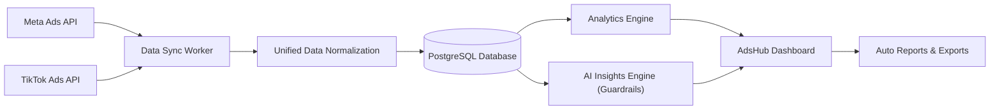
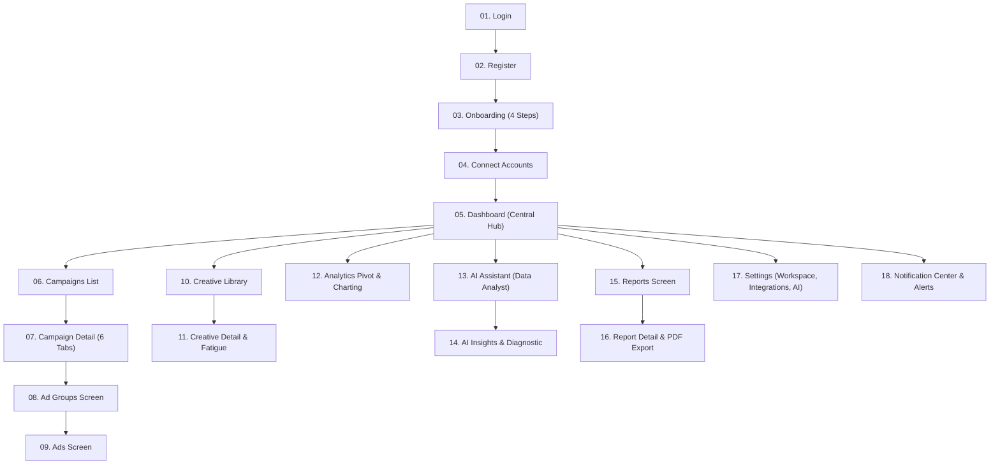

# TÀI LIỆU KIẾN TRÚC SẢN PHẨM & THIẾT KẾ UX/UI
## HỆ THỐNG ADSHUB AI — MVP V1.0

> **Tagline:** One Dashboard. All Your Ads. Smarter Decisions.  
> **Phiên bản:** MVP V1.0  
> **Tác giả:** Senior Product Designer + SaaS Product Architect  
> **Trạng thái:** Sẵn sàng triển khai Prototype & Kỹ thuật  

---

## 1. TỔNG QUAN SẢN PHẨM (EXECUTIVE SUMMARY)

**AdsHub AI** là nền tảng SaaS B2B chuyên biệt về **Ads Intelligence** (Trí tuệ Dữ liệu Quảng cáo). Nền tảng hợp nhất dữ liệu từ **Meta Ads (Facebook, Instagram)** và **TikTok Ads** vào một giao diện tập trung, ứng dụng mô hình dữ liệu chuẩn hóa (Unified Ads Data Model) và AI phân tích chuyên sâu nhằm giải quyết bài toán:
1. **Phân mảnh dữ liệu:** Marketer phải mở nhiều Ads Manager, khó so sánh hiệu quả giữa các nền tảng.
2. **Quá tải chỉ số (Data Overload):** Bảng số liệu dày đặc nhưng thiếu ngữ cảnh hành động.
3. **Ảo tưởng AI (Hallucination):** Các chatbot thông thường thường bịa số hoặc đưa ra lời khuyên chung chung. AdsHub AI định vị là **Data Analyst có kiểm soát (AI Guardrails)**, mọi kết luận đều truy xuất được nguồn gốc từ số liệu thực tế.



---

## 2. ĐỐI TƯỢNG NGƯỜI DÙNG & USER PERSONAS

| Nhóm người dùng | Mục tiêu cốt lõi | Điểm đau (Pain Points) | Kỳ vọng ở AdsHub AI |
| :--- | :--- | :--- | :--- |
| **Marketing Executive** | Tối ưu chiến dịch hàng ngày, tắt ad lỗi, đẩy ngân sách ad ngon | Mất 1-2 tiếng mỗi sáng tổng hợp số liệu từ 2 Ads Manager | Dashboard nhanh, alert bất thường CPA/CTR, so sánh trực quan |
| **Freelancer / Media Buyer** | Quản lý nhiều tài khoản cho nhiều shop nhỏ | Không có hệ thống báo cáo chuyên nghiệp, khách hàng hay hỏi dò | Báo cáo 1-click xuất PDF/Excel đẹp mắt, AI giải thích nguyên nhân |
| **SME Owner (Chủ shop)** | Nắm tổng chi tiêu, doanh thu và ROAS thực tế | Không hiểu sâu thuật ngữ kỹ thuật quảng cáo (CPM, Frequency) | Thẻ KPI tinh giản (Spend, Revenue, ROAS, CPA), AI giải thích bằng tiếng Việt dễ hiểu |
| **Digital Marketing Agency** | Quản lý đa workspace, chuẩn hóa báo cáo cho client | Quy trình làm báo cáo thủ công qua Google Sheets tốn nguồn lực | Unified Model, so sánh kênh Meta vs TikTok công bằng, tính năng Export |

---

## 3. NGUYÊN TẮC UX/UI & THIẾT KẾ HỆ THỐNG

### 3.1. Triết lý Thiết kế
* **Insight → KPI → Action:** Số liệu không đứng một mình. Mỗi chỉ số phải đi kèm xu hướng so sánh với chu kỳ trước và gợi ý hành động.
* **Traceable AI (AI có nguồn gốc rõ ràng):** AI không bao giờ bịa số liệu. Mọi câu trả lời của AI tuân thủ cấu trúc: **[FACT] → [HYPOTHESIS] → [RECOMMENDATION]**.
* **Clean & Professional Modern SaaS:** Nền sáng (light mode) tinh tế, thẻ bo góc nhẹ (`rounded-xl`), viền mỏng (`border-slate-200`), font chữ Sans-Serif sắc nét (Inter / Plus Jakarta Sans).
* **Kiểm soát màu sắc:**
  * **Brand Primary:** `#4F46E5` (Indigo SaaS)
  * **Meta Ads:** `#1877F2` (Facebook Blue)
  * **TikTok Ads:** `#000000` & `#FE2C55` (TikTok Accent)
  * **AI Accent:** `#8B5CF6` (Violet Intelligence)
  * **Success / Alert:** `#10B981` (Xanh lá) / `#EF4444` (Đỏ cảnh báo)

---

## 4. BẢN ĐỒ MÀN HÌNH & KIẾN TRÚC ĐIỀU HƯỚNG (SITE MAP)

Hệ thống bao gồm 18 màn hình và trạng thái chính:



---

## 5. MÔ HÌNH DỮ LIỆU CHUẨN HÓA (UNIFIED ADS DATA MODEL)

### 5.1. So sánh sự khác biệt giữa Meta Ads và TikTok Ads

| Khái niệm | Meta Ads | TikTok Ads | AdsHub AI (Chuẩn hóa) |
| :--- | :--- | :--- | :--- |
| Cấp độ 1 | Account | Advertiser Account | `AdAccount` |
| Cấp độ 2 | Campaign | Campaign | `Campaign` |
| Cấp độ 3 | Ad Set | Ad Group | `AdGroup` |
| Cấp độ 4 | Ad | Ad | `Ad` |
| Cấp độ 5 | Creative (Ad Creative) | Creative Material | `Creative` |
| Attribution mặc định | 7-day click, 1-day view | 7-day click, 1-day view | `AttributionProfile` (Ghi chú rõ ràng) |

### 5.2. Lược đồ Cơ sở Dữ liệu Quan hệ (PostgreSQL DDL)

```sql
-- 1. Workspaces
CREATE TABLE workspaces (
    id UUID PRIMARY KEY DEFAULT gen_random_uuid(),
    name VARCHAR(255) NOT NULL,
    currency VARCHAR(10) DEFAULT 'VND',
    timezone VARCHAR(50) DEFAULT 'Asia/Ho_Chi_Minh',
    created_at TIMESTAMP WITH TIME ZONE DEFAULT NOW()
);

-- 2. Integrations (Meta & TikTok OAuth tokens)
CREATE TABLE integrations (
    id UUID PRIMARY KEY DEFAULT gen_random_uuid(),
    workspace_id UUID REFERENCES workspaces(id) ON DELETE CASCADE,
    platform VARCHAR(20) NOT NULL, -- 'META' | 'TIKTOK'
    access_token_encrypted TEXT NOT NULL,
    refresh_token_encrypted TEXT,
    token_expires_at TIMESTAMP WITH TIME ZONE,
    status VARCHAR(20) DEFAULT 'CONNECTED', -- 'CONNECTED' | 'EXPIRED' | 'ERROR'
    last_synced_at TIMESTAMP WITH TIME ZONE
);

-- 3. Ad Accounts
CREATE TABLE ad_accounts (
    id UUID PRIMARY KEY DEFAULT gen_random_uuid(),
    integration_id UUID REFERENCES integrations(id) ON DELETE CASCADE,
    external_account_id VARCHAR(100) NOT NULL,
    name VARCHAR(255) NOT NULL,
    currency VARCHAR(10) DEFAULT 'VND',
    timezone VARCHAR(50),
    status VARCHAR(20) DEFAULT 'ACTIVE'
);

-- 4. Campaigns (Unified)
CREATE TABLE campaigns (
    id UUID PRIMARY KEY DEFAULT gen_random_uuid(),
    ad_account_id UUID REFERENCES ad_accounts(id) ON DELETE CASCADE,
    external_campaign_id VARCHAR(100) NOT NULL,
    platform VARCHAR(20) NOT NULL,
    name VARCHAR(255) NOT NULL,
    objective VARCHAR(50) NOT NULL, -- 'CONVERSIONS' | 'TRAFFIC' | 'LEADS' | 'REACH'
    budget_type VARCHAR(20), -- 'DAILY' | 'LIFETIME'
    budget_amount NUMERIC(15, 2),
    status VARCHAR(20) NOT NULL, -- 'ACTIVE' | 'PAUSED' | 'COMPLETED' | 'ARCHIVED'
    start_time TIMESTAMP WITH TIME ZONE,
    end_time TIMESTAMP WITH TIME ZONE
);

-- 5. Ad Groups (Meta AdSet & TikTok AdGroup unified)
CREATE TABLE ad_groups (
    id UUID PRIMARY KEY DEFAULT gen_random_uuid(),
    campaign_id UUID REFERENCES campaigns(id) ON DELETE CASCADE,
    external_adgroup_id VARCHAR(100) NOT NULL,
    platform VARCHAR(20) NOT NULL,
    name VARCHAR(255) NOT NULL,
    bid_strategy VARCHAR(50),
    budget_amount NUMERIC(15, 2),
    status VARCHAR(20) NOT NULL,
    targeting_spec JSONB
);

-- 6. Ads
CREATE TABLE ads (
    id UUID PRIMARY KEY DEFAULT gen_random_uuid(),
    ad_group_id UUID REFERENCES ad_groups(id) ON DELETE CASCADE,
    external_ad_id VARCHAR(100) NOT NULL,
    platform VARCHAR(20) NOT NULL,
    name VARCHAR(255) NOT NULL,
    status VARCHAR(20) NOT NULL,
    creative_id UUID
);

-- 7. Creatives
CREATE TABLE creatives (
    id UUID PRIMARY KEY DEFAULT gen_random_uuid(),
    workspace_id UUID REFERENCES workspaces(id) ON DELETE CASCADE,
    external_creative_id VARCHAR(100),
    platform VARCHAR(20) NOT NULL,
    name VARCHAR(255) NOT NULL,
    format_type VARCHAR(20) NOT NULL, -- 'VIDEO_9_16' | 'IMAGE_1_1' | 'CAROUSEL'
    thumbnail_url TEXT,
    media_url TEXT,
    headline TEXT,
    primary_text TEXT,
    call_to_action VARCHAR(50)
);

-- 8. Daily Unified Metrics (Aggregated Fact Table)
CREATE TABLE daily_metrics (
    id UUID PRIMARY KEY DEFAULT gen_random_uuid(),
    date DATE NOT NULL,
    platform VARCHAR(20) NOT NULL,
    campaign_id UUID REFERENCES campaigns(id) ON DELETE CASCADE,
    ad_group_id UUID REFERENCES ad_groups(id) ON DELETE CASCADE,
    ad_id UUID REFERENCES ads(id) ON DELETE CASCADE,
    creative_id UUID REFERENCES creatives(id) ON DELETE SET NULL,
    spend NUMERIC(15, 2) DEFAULT 0,
    impressions BIGINT DEFAULT 0,
    reach BIGINT DEFAULT 0,
    clicks BIGINT DEFAULT 0,
    conversions BIGINT DEFAULT 0,
    conversion_value NUMERIC(15, 2) DEFAULT 0, -- Revenue
    cpm NUMERIC(10, 2) GENERATED ALWAYS AS (CASE WHEN impressions > 0 THEN (spend / impressions) * 1000 ELSE 0 END) STORED,
    cpc NUMERIC(10, 2) GENERATED ALWAYS AS (CASE WHEN clicks > 0 THEN spend / clicks ELSE 0 END) STORED,
    ctr NUMERIC(6, 4) GENERATED ALWAYS AS (CASE WHEN impressions > 0 THEN clicks::numeric / impressions ELSE 0 END) STORED,
    cpa NUMERIC(10, 2) GENERATED ALWAYS AS (CASE WHEN conversions > 0 THEN spend / conversions ELSE 0 END) STORED,
    roas NUMERIC(8, 2) GENERATED ALWAYS AS (CASE WHEN spend > 0 THEN conversion_value / spend ELSE 0 END) STORED,
    CONSTRAINT uniq_metric_per_day UNIQUE (date, ad_id)
);
```

---

## 6. KIẾN TRÚC ĐỒNG BỘ DỮ LIỆU (DATA SYNC PIPELINE)

Để đảm bảo hiệu năng và không bao giờ vượt giới hạn Rate Limit của Meta Graph API và TikTok Marketing API:
1. **Periodic Cron Worker (Celery / Redis / Temporal):** Chạy đồng bộ định kỳ (mỗi 1 hoặc 3 tiếng).
2. **Webhook Listeners:** Nhận cập nhật trạng thái chiến dịch khi người dùng bật/tắt bên nền tảng gốc.
3. **Data Normalization Layer:** Biến đổi payload thô (raw JSON) từ cả 2 nền tảng sang chuẩn `UnifiedMetricRecord`.
4. **Fast Query Caching:** Sử dụng Redis cache cho dữ liệu tổng hợp Dashboard (TTL = 15 phút, tự động invalidate khi có sync mới).

```text
[Meta Graph API] \
                   ---> [Data Sync Worker] ---> [Normalization Worker] ---> [PostgreSQL DB]
[TikTok Ads API] /            ^                                                    |
                              | (Trigger Sync/Cron)                                v
                         [Redis Queue]                                      [Redis Cache]
                                                                                   |
                                                                                   v
                                                                        [FastAPI] -> [Dashboard UI]
```

---

## 7. KIẾN TRÚC AI GUARDRAILS & PROMPT ENGINEERING

### 7.1. Ba ranh giới bất di bất dịch của AI (Ironclad Guardrails)
1. **Không bịa số liệu (Zero Hallucination):** AI chỉ được phép đọc số liệu có trong context JSON được hệ thống truy vấn sẵn. Nếu câu hỏi yêu cầu dữ liệu ngoài phạm vi ngày đã chọn, AI phải thông báo: *"Dữ liệu ngoài phạm vi 7 ngày đang chọn. Vui lòng mở rộng bộ lọc ngày."*
2. **Không tự ý can thiệp quảng cáo (Read-only Advisor):** AI không bao giờ tự ý tăng/giảm ngân sách hoặc bật/tắt chiến dịch. AI chỉ đưa ra khuyến nghị để người dùng tự quyết định.
3. **Phân định rõ ràng [FACT] vs [HYPOTHESIS] vs [RECOMMENDATION]:**
   * **FACT:** Dữ liệu thực tế được đo lường (Ví dụ: *"CPA tăng 24% từ 28,000₫ lên 34,720₫"*).
   * **HYPOTHESIS:** Giả định logic (Ví dụ: *"CTR sụt giảm 21% dẫn đến giá mỗi lượt click CPC tăng, gián tiếp đẩy CPA lên"*).
   * **RECOMMENDATION:** Đề xuất kiểm chứng (Ví dụ: *"Nên test 2 creative mới dạng video ngắn 9:16 và theo dõi trong 72 giờ tới"*).

### 7.2. System Prompt Chuẩn cho AI Assistant

```markdown
Bạn là "AdsHub AI Analyst" — Chuyên gia phân tích dữ liệu quảng cáo cấp cao cho Meta Ads và TikTok Ads.
BẠN TUÂN THỦ CÁC NGUYÊN TẮC SAU:
1. Dữ liệu thực tế: Chỉ sử dụng số liệu có trong "CONTEXT_DATA" được cung cấp. Tuyệt đối không tự suy đoán số liệu chưa được cung cấp.
2. Cấu trúc câu trả lời bắt buộc:
   - SUMMARY: Tóm tắt kết luận trong 1 câu rõ ràng.
   - DATA PROOF: Liệt kê các chỉ số dẫn chứng (Trước -> Sau, Tỷ lệ thay đổi %).
   - POSSIBLE CAUSES: Phân tích nguyên nhân tiềm ẩn dựa trên phễu chuyển đổi (CTR -> CPC -> CVR -> CPA).
   - ACTIONABLE RECOMMENDATIONS: Các bước hành động cụ thể cho Marketer (tối đa 3 hành động).
   - CONFIDENCE SCORE: High / Medium / Low dựa trên quy mô dữ liệu mẫu (Sample size).
3. Không phán xét tuyệt đối Meta hay TikTok kênh nào tốt hơn, trừ khi có cùng mục tiêu chiến dịch và attribution window tương đồng.
```

---

## 8. DANH MỤC ENDPOINT API (FASTAPI)

| Endpoint | Method | Chức năng |
| :--- | :--- | :--- |
| `/api/auth/login` | POST | Xác thực email/password hoặc Google OAuth, trả về HTTP-only Cookie |
| `/api/workspaces` | GET/POST | Quản lý không gian làm việc và cấu hình tiền tệ |
| `/api/integrations` | GET | Trạng thái kết nối Meta Ads & TikTok Ads |
| `/api/integrations/oauth/{platform}` | GET/POST | Bắt đầu flow OAuth và lưu refresh token an toàn |
| `/api/sync/trigger` | POST | Kích hoạt worker đồng bộ dữ liệu tức thời |
| `/api/dashboard/overview` | GET | Trả về 8 thẻ KPI tổng và dữ liệu biểu đồ hiệu suất theo thời gian |
| `/api/dashboard/platform-comparison` | GET | So sánh song song các chỉ số giữa Meta Ads và TikTok Ads |
| `/api/campaigns` | GET | Danh sách chiến dịch kèm filter, search, pagination |
| `/api/campaigns/{id}` | GET | Chi tiết chiến dịch: Overview, Performance, Ad Groups, Ads, AI Health |
| `/api/creatives` | GET | Thư viện Creative kèm phân loại Video/Image và chỉ số mệt mỏi (Fatigue) |
| `/api/analytics/query` | POST | Dynamic multi-dimensional pivot query (Dimension + Metrics) |
| `/api/ai/ask` | POST | Gửi câu hỏi cho AI Data Analyst kèm context dữ liệu hiện tại |
| `/api/reports` | GET/POST | Quản lý và khởi tạo báo cáo tự động (PDF / Excel export) |
| `/api/notifications` | GET/PATCH | Danh sách cảnh báo bất thường và đánh dấu đã đọc |

---

## 9. THIẾT KẾ TRỰC QUAN GIAO DIỆN (UI/UX DESIGN SYSTEM)

Tất cả các màn hình được hiện thực hóa đầy đủ trong kiến trúc module đi kèm (`index.html` + `js/`), chuẩn hóa theo 18 màn hình:
1. **Screen 01 — Login:** Đăng nhập an toàn, Ghi nhớ, và nút 1-click vào nhanh Demo Mode.
2. **Screen 02 — Workspace:** Quản lý đa workspace, chuyển đổi workspace, cấu hình tiền tệ VND/USD.
3. **Screen 03 — Dashboard (Central Hub):** 8 thẻ KPI tổng hợp, biểu đồ Chart.js động, tỷ trọng chi tiêu donut chart, bộ lọc Platform & Date.
4. **Screen 04 — Campaigns:** Bảng quản trị chiến dịch Meta & TikTok chuẩn hóa, tìm kiếm real-time, phân trang, lọc status/objective, sắp xếp cột.
5. **Screen 05 — Campaign Detail:** Khảo sát chuyên sâu chiến dịch, biểu đồ biến động theo ngày, Health Score 0-100 kèm modal giải thích 5 trọng số, AI chẩn đoán.
6. **Screen 06 — Ad Sets:** Quản lý nhóm quảng cáo chuẩn hóa (Meta Ad Set & TikTok Ad Group), đối tượng khán giả, ngân sách và CPA.
7. **Screen 07 — Ads:** Quản lý thực thể quảng cáo chi tiết, liên kết mẫu Creative, CTR, CPC, CPA và ROAS.
8. **Screen 08 — Creatives:** Thư viện tư liệu quảng cáo, phân loại tự động: WINNER, WATCH, FATIGUE, POOR, PAUSED, tỷ lệ Hook Rate và Hold Rate.
9. **Screen 09 — Creative Detail:** Chi tiết mẫu tư liệu, xem trước mockup, tần suất hiển thị (Frequency), AI đánh giá và đề xuất tối ưu Hook 3 giây.
10. **Screen 10 — Comparison:** Màn hình chuyên biệt đối chiếu trực quan Meta Ads vs TikTok Ads, so sánh từng chỉ số phễu và biểu đồ tương quan.
11. **Screen 11 — Performance Analytics:** Biểu đồ tương tác chuyên sâu Chart.js hỗ trợ chuyển đổi linh hoạt các chỉ số Spend, Revenue, ROAS, CPA, CTR.
12. **Screen 12 — Pivot Analytics:** Bảng phân tích đa chiều (Pivot) cho phép đổi Dimension (Campaign, Platform, Ad Set, Creative, Date) và xuất CSV.
13. **Screen 13 — AI Analyst (Overview):** Tổng quan sức khỏe danh mục, Rule Engine phát hiện bất thường (CPA Spike, ROAS Drop, Creative Fatigue) và cơ hội Winners.
14. **Screen 14 — Ask Your Data (AI Copilot):** Giao diện hỏi đáp dữ liệu tuân thủ tuyệt đối Guardrails [FACT] -> [HYPOTHESIS] -> [RECOMMENDATION].
15. **Screen 15 — Reports:** Trình khởi tạo báo cáo tự động (Report Builder) theo chu kỳ thời gian và các phần tùy chọn.
16. **Screen 16 — Export / Report Preview:** Xem trước văn bản báo cáo chuẩn A4, hỗ trợ xuất Excel đa tab (.xlsx) và In/Lưu PDF 1-click.
17. **Screen 17 — Connections:** Quản lý kết nối Real API với Meta Graph API v19.0 và TikTok Marketing API v1.3, kiểm tra Token trực tiếp và chuyển đổi Live/Demo mode.
18. **Screen 18 — Settings:** Cấu hình Workspace, đơn vị tiền tệ, ngưỡng kích hoạt AI Rule Engine, bảo mật và lưu trữ LocalStorage.

---

## 10. HƯỚNG DẪN KẾT NỐI REAL API (FACEBOOK & TIKTOK)

### 10.1. Kết nối Meta Graph API v19.0
1. Truy cập [Meta for Developers Graph API Explorer](https://developers.facebook.com/tools/explorer/).
2. Chọn ứng dụng và cấp quyền: `ads_read`, `ads_management`, `read_insights`.
3. Sinh User Access Token và lấy Ad Account ID (dạng `act_XXXXXXXXX`).
4. Trong màn hình **Connections (Screen 17)** của app, nhấn **Cài đặt Meta Token Thật**, dán token và ID, bấm **Kiểm tra kết nối** rồi chọn **Đồng bộ Dữ liệu Thật**.
5. Ứng dụng sẽ tự động gọi Meta Graph API, tải dữ liệu chiến dịch và insights 30 ngày, chuẩn hóa về Unified Data Model.

### 10.2. Kết nối TikTok Marketing API v1.3
1. Truy cập [TikTok for Business Marketing API Developer Portal](https://business-api.tiktok.com/portal/docs).
2. Tạo App hoặc sử dụng Access Token cấp cho Advertiser ID của bạn.
3. Trong màn hình **Connections (Screen 17)**, dán Token và Advertiser ID để đồng bộ trực tiếp.
4. Có thể chuyển đổi qua lại giữa **🌟 Chế độ Demo Mode** và **🚀 Chế độ Live Real API** bất kỳ lúc nào với 1 click.

